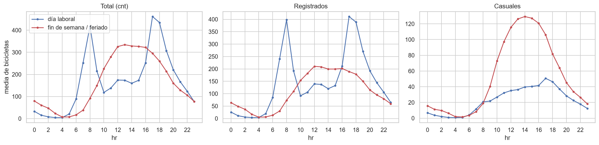
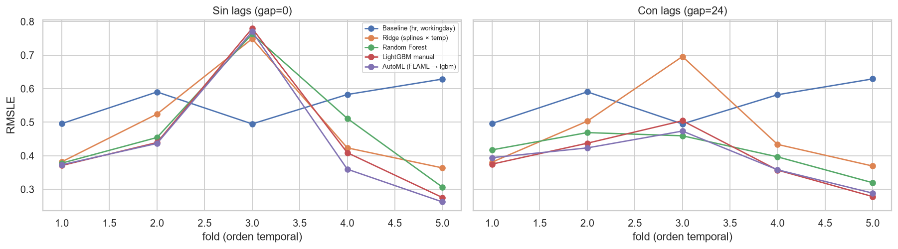
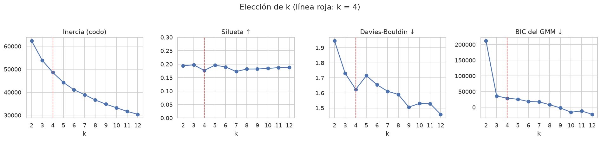
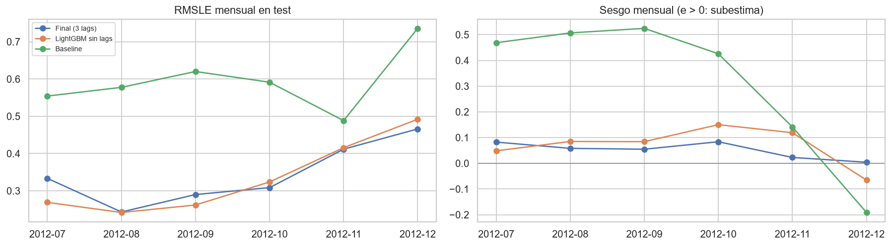
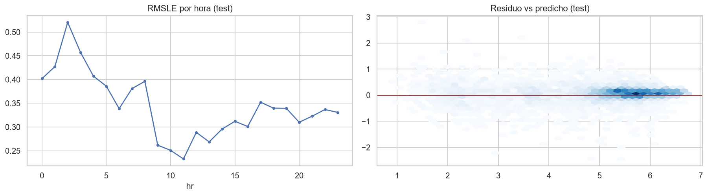
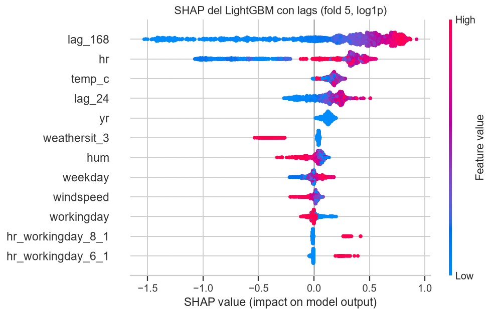
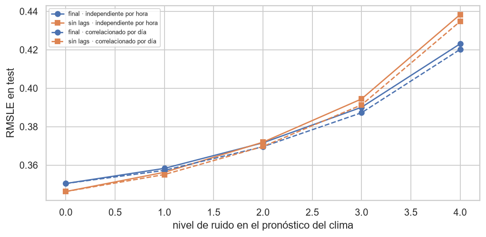
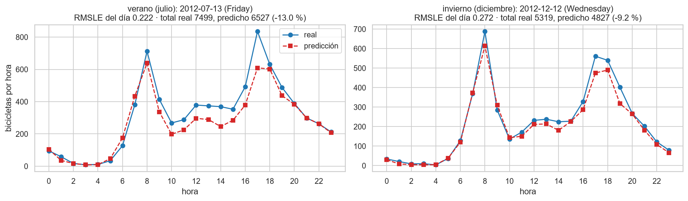
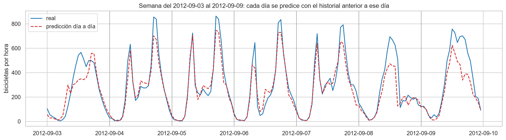

# Predicción de la demanda horaria de bicicletas compartidas (Bike Sharing Demand)

**Proyecto Integrador, Parte I (EC2) · Metodología CRISP-DM**
Equipo: Joan, Pardo y José · Dataset: UCI *Bike Sharing Dataset* (Capital Bikeshare, Washington D.C.), fecha de acceso 17/10/2026.

> Todas las cifras de este informe salen de código ejecutado en los notebooks del repositorio (se indica el notebook o la ficha de `reports/decisiones.md`). ✅ = verificado con los datos · 🔶 = hipótesis razonada, no probada · ⏳ = pendiente.

---

## Resumen

Se construyó un modelo que predice la demanda horaria total de bicicletas compartidas de la ciudad para el **día siguiente (24 horas), con el pronóstico emitido a las 00:00**. El modelo final es un **LightGBM** entrenado sobre `log1p(demanda)` con la demanda observada hace 1, 7 y 14 días a la misma hora (`lag_24`, `lag_168`, `lag_336`) y las variables de calendario y clima.

| Evaluación | RMSLE | RMSE | MAE | R² |
| :--- | :---: | :---: | :---: | :---: |
| Validación temporal (solo train, 5 folds) | 0.3732 ± 0.0566 | | | |
| **Test, jul–dic 2012 (una sola evaluación)** | **0.3505** | 69.99 | 43.11 | 0.8985 |
| Baseline de calendario en test | 0.5999 | 150.35 | 107.21 | 0.5316 |

El modelo reduce el error del baseline en un **41.6 %** y la validación no sobreestimó el rendimiento. Se señalan con la misma claridad sus límites: tiende a **subestimar** (−6.9 % en el total diario), falla más en **clima adverso, feriados y madrugada**, y **depende de los lags** (sin historial predice un 85 % menos). Además, en el test de verano los lags no mejoraron a la versión sin ellos (0.3463), un riesgo que la validación no podía medir porque ningún fold cubría julio ni agosto.

---

## 1. Comprensión del negocio y formulación

**Problema.** Los sistemas de bicicletas compartidas tienen una demanda horaria que depende del clima, de la rutina laboral y de la estacionalidad. Anticiparla permite planificar la flota y su redistribución.

**Tipo de problema y target.** Regresión supervisada sobre datos tabulares con estructura temporal. Target: `cnt`, la demanda total de la ciudad por hora (no por estación; por eso no se pueden sacar conclusiones por estación).

**Horizonte.** Día siguiente, con el pronóstico emitido a las 00:00. Con ese horizonte están disponibles los lags de 24 h y 168 h (y 336 h). El clima de entrada sería un pronóstico, no el valor observado; esto se evalúa en la validación operativa (sección 10).

**Criterio de éxito.** Métrica primaria **RMSLE** (error en escala logarítmica): penaliza errores relativos y, a igual error absoluto, castiga más la subestimación. Entrenar sobre `log1p(cnt)` con pérdida cuadrática la optimiza. Secundarias: MAE (bicicletas), RMSE y R², calculadas en escala original. **Umbral de éxito (propuesta de Joan, fijada a posteriori):** mejorar al menos un **30 %** el RMSLE de validación del baseline de calendario (0.5585), es decir, un RMSLE de validación ≤ 0.3910. Contraste con lo obtenido: validación 0.3732 (−33.2 %, cumple) y test 0.3505 frente a 0.5999 (−41.6 %). ⚠️ Este umbral se propuso **después** de ver los resultados de validación y de test: en los Sprints 1 a 3 solo se usó el baseline (0.5585) como referencia, sin un porcentaje fijado. Por tanto no es un criterio previo, y que el resultado lo supere no lo valida como tal; sigue siendo una decisión del grupo (⏳).

**Riesgos.** (1) Fuga de variables: `casual` y `registered` suman `cnt`. (2) Fuga temporal: prohibido el K-Fold aleatorio. (3) El crecimiento de la demanda entre 2011 y 2012, que los árboles no extrapolan.

---

## 2. Comprensión de los datos

**Fuente y variante.** `hour.csv`: 17 379 filas × 17 columnas, de 731 días (2011-01-01 a 2012-12-31). Se usan todas las filas, sin submuestreo. Cita obligatoria: Fanaee-T y Gama (2013), *Event labeling combining ensemble detectors and background knowledge*, Progress in Artificial Intelligence, doi:10.1007/s13748-013-0040-3.

**Variables.** `season`, `yr`, `mnth`, `hr`, `holiday`, `weekday`, `workingday`, `weathersit` (1 despejado a 4 lluvia o nieve intensa), `temp`, `atemp`, `hum` y `windspeed` (normalizadas con ÷41, ÷50, ÷100 y ÷67), `casual`, `registered` (excluidas como entrada) y `cnt` (target). `instant` y `dteday` crudos no se usan como entrada.

**Partición.** Train: 2011-01-01 a 2012-06-30 (13 128 horas, 74.8 %; 13 003 con registro). Test: 2012-07-01 a 2012-12-31 (4 416 horas; 4 376 con registro), hold-out de una sola evaluación. Validación dentro de train con `TimeSeriesSplit` de ventana expansiva, 5 folds de 1 460 horas (≈ 2 meses), con el primer fold entrenando con ≈ 8 meses. Las ventanas de validación cubren del 2011-08-31 al 2012-06-30: **ningún fold valida julio ni agosto** (✅, notebook 03).

### 2.1 Calidad de los datos (notebook 01)

| Hallazgo | Dato verificado | Decisión |
| :--- | :--- | :--- |
| Horas ausentes | 165 de 17 544 (0.94 %); 84 en las horas 2–4; ene-2011 (56), oct-2012 (36); racha máxima de 36 horas, mediana de 1 | Reindexar a las 17 544 horas antes de cualquier `shift`; target NaN y excluido del ajuste y de la métrica |
| `windspeed = 0` | 2 180 filas (12.5 %); el siguiente valor distinto es 0.0896 (≈ 6 km/h) | 🔶 posible umbral del sensor; ablación con LightGBM sin efecto medible (se mantiene el valor) |
| `hum = 0` | 22 filas, todas el 2011-03-10 | Imputar con la mediana de train |
| `weathersit = 4` | 3 filas (0.017 %), las tres en train | Fusionar con la categoría 3 |
| `temp` frente a `atemp` | r = 0.9877; VIF 68.65 y 68.78 | `temp_c` y `temp_diff = atemp_c − temp_c`: VIF 1.40 y 1.52 |

---

## 3. Análisis exploratorio (solo con train; notebook 01)

1. **La dinámica horaria depende del tipo de día.** En días laborables hay dos picos, a las 8:00 (≈ 418 bicicletas/hora) y a las 17:00 (≈ 462); en fines de semana y feriados, una campana con máximo a las 13:00 (≈ 334). Los usuarios registrados reproducen los picos laborales; los casuales dominan el fin de semana (32.8 % de los viajes frente a 13.4 % en días laborables). **Decisión:** la categoría combinada `hr_workingday` (48 niveles), no el producto numérico.
2. **Distribución del target.** `cnt` tiene asimetría positiva (1.29; mediana 124 frente a media 167.7). Con `log1p` pasa a −0.81: se reduce en valor absoluto pero no queda simétrica; la razón principal de usar `log1p` es alinear el entrenamiento con el RMSLE.
3. **Tendencia.** Comparando el mismo semestre (ene–jun) la demanda media pasa de 123.4 a 215.2 bicicletas/hora (**+74 %**; registrados +78 %, casuales +61 %); la razón 2012/2011 por mes baja de 2.53 (marzo) a 1.41 (junio). 🔶 No puede afirmarse qué ocurre en la segunda mitad de 2012 con estos datos.
4. **Clima.** La demanda media es 183.4 con clima 1, 152.0 con clima 2 y 93.9 con clima 3 (8.7 % de las filas de train). La temperatura es el factor más fuerte (de 48.6 bicicletas en ≤ 5 °C a 289.7 por encima de 30 °C).
5. **Evento Sandy (2012-10-29/30).** Cae en el test; el 29-oct solo hay una hora registrada. Solo se documentó la estructura antes del test.

---

## 4. Preparación de los datos (`src/data_loader.py`, `src/features.py`)

- **Serie continua:** `load_data()` reindexa a 17 544 horas y reconstruye el calendario de las horas ausentes; el clima y el target quedan en NaN (no se inventa).
- **Preprocesador:** `Pipeline` con transformaciones sin estado (`weathersit = 4 → 3`, `temp_c`, `temp_diff`, `hr_workingday`) y un `ColumnTransformer` con One-Hot de `season`, `weathersit` y `hr_workingday`, imputación por mediana de train y escalado solo para modelos lineales. Todo lo que se aprende se ajusta solo con train.
- **Lags:** `agregar_lags` crea `lag_24`, `lag_168` y `lag_336` sobre la serie completa reindexada (por eso importa la reindexación); solo miran el pasado de cada hora.
- **Control de fuga:** `casual`, `registered`, `instant` y `dteday` crudo no entran; los clusters se ajustan sin el target; el test no se usa hasta la evaluación final.

---

## 5. Modelado supervisado

### 5.1 Baselines y modelos (validación temporal, solo train)

| Modelo | RMSLE medio ± std (5 folds) | Fuente |
| :--- | :---: | :--- |
| Baseline: media de `cnt` por `(hr, workingday)` | 0.5585 ± 0.0601 | notebook 03 |
| Regresión lineal sobre variables crudas | 1.1055 ± 0.0951 | notebook 03 |
| Ridge (splines de la hora × temperatura) | 0.4885 ± 0.1583 | notebook 03b, ficha 9 |
| Random Forest tuneado | 0.4826 ± 0.1748 | notebook 05 (03c y ficha 12: 0.4827; ver nota) |
| LightGBM con tuning | 0.4549 ± 0.1918 | notebook 03, ficha 4 |
| AutoML (FLAML → LightGBM) | 0.4405 ± 0.1946 | notebook 04, ficha 14 |

> **Nota sobre Random Forest (±0.0001 entre equipos).** Las cifras de Random Forest de este informe (0.4826 sin lags y 0.4125 con lags) se calcularon en el notebook 05 en el equipo de Joan; el notebook 03c de José, ejecutado en otro equipo, da 0.4827 y 0.4124 (fichas 12 y 13). La diferencia es de 0.0001 y no cambia ninguna conclusión; el Random Forest con `n_jobs = -1` no reproduce la cuarta cifra decimal entre máquinas.

- **El baseline de calendario es fuerte** (explica ≈ 62 % de la varianza) y la regresión lineal cruda falla por su forma (RMSLE 1.0175 incluso dentro de train): la hora tiene dos picos y no es monótona.
- **Ridge** (Pardo): la codificación de la hora solo importa sin la interacción; con `hr_workingday` splines, One-Hot y sin/cos empatan (0.4930–0.4932). Lo que mejora (en los 5 folds) es la interacción hora × temperatura. Lasso no mejora.
- **LightGBM:** las ablaciones de preparación no cambiaron nada medible (`sin_yr` empeora a 0.5370; `windspeed` y `hum` sin efecto), el tuning con `RandomizedSearchCV` + `TimeSeriesSplit` bajó el RMSLE de 0.4643 a 0.4549 con mejora en los 5 folds, y la variación entre semillas fue de 0.0002. Las diferencias entre modelos (≈ 0.03) son menores que la desviación entre folds (0.16–0.19), por lo que se comparan fold a fold.
- **Pruebas sin adoptar** (ficha 5 y 6): objetivo Poisson (0.4473, peor en 2 folds) y factor de *smearing* de Duan (φ ≈ 1.028; peor en 2 folds).
- **El fold 3 domina el error:** valida de ene a mar de 2012 con un train solo de 2011; ningún modelo había visto el nivel más alto de 2012.

### 5.2 Los lags de demanda y el horizonte (notebooks 05 y 06)

Con lags, el nivel reciente de demanda entra al modelo y corrige gran parte del error del fold 3. Con `get_cv(gap = 24)`:

| Escenario | LightGBM manual | AutoML (config sin lags) |
| :--- | :---: | :---: |
| Sin lags | 0.4562 | 0.4417 |
| Semana: `lag_168` + `lag_336` | 0.3893 | 0.3863 |
| Día (00:00): `lag_24` + `lag_168` | 0.3905 | 0.3855 |
| **Día (00:00): los tres lags** | **0.3732 ± 0.0566** | 0.3738 ± 0.0673 |
| Día emitido a las 18:00, tres lags | 0.3823 | 0.3826 |
| Falla de `lag_24` (entrenado con los tres) | **0.3862** | 0.3985 |

- Los lags **no obligan a un horizonte diario**: el esquema semanal (`lag_168` + `lag_336`) casi iguala al diario con dos lags; con los tres lags el día supera a la semana en 0.0188 (IC95 % por bootstrap de días [−0.0243, −0.0133], optimista).
- Con los tres lags LightGBM manual empata con AutoML en precisión (diferencia −0.0020, IC95 % [−0.0081, 0.0039]) y es **más robusto si falta `lag_24`**.
- **Formalmente la combinación no cumple la regla de adopción del equipo** (mejora la media en 18.2 % pero empeora 2 de 5 folds); se adoptó porque la ganancia es grande en el fold más difícil. 🔶 La regla es conservadora con mejoras que dependen de un fold.

### 5.3 Selección del modelo final

Se eligió **LightGBM manual con los tres lags**, con la validación y **antes de ver el test**: es el mejor y el más estable en validación, el más robusto ante la falta de `lag_24`, empata con AutoML y no depende de una búsqueda no reproducible. Descartados: Random Forest, Ridge y baseline (con lags 0.4125, 0.4766 y 0.5586 frente a 0.3905 con dos lags). Fichas 20 y 21.

---

## 6. Aprendizaje no supervisado (notebook 02, Pardo)

K-Means sobre `hr_sin`, `hr_cos`, `temp`, `hum`, `windspeed` y `workingday`, ajustado solo con train. Los índices internos no deciden el número de clusters (silueta 0.17–0.20 para todo k; el BIC del GMM no tiene mínimo), por lo que se eligió **k = 4** por estabilidad (ARI entre semillas 0.997; entre 2011 y todo train 0.955) e interpretabilidad. Arquetipos: tarde cálida y seca (demanda media 278), mañana laborable (138), no laborable (125) y noche laborable (118).

La estructura es **débil**: los clusters explican el 17.5 % de la varianza de `log1p(cnt)` frente al 81 % de hora × `workingday`. Por eso se usan para **segmentar el error**, no como variable de entrada. Ningún cluster captura el clima adverso porque el clima no es entrada del clustering. PCA reparte la varianza (4 componentes para 79 %); UMAP muestra dos bloques por `workingday` con un gradiente horario continuo.

---

## 7. AutoML como benchmark (notebook 04, José)

Se usó **FLAML** (corre en Python 3.13 y no necesita Java; PyCaret 3.3 exige Python ≤ 3.11), con el mismo `TimeSeriesSplit` de `get_cv()` pasado como `split_type`, `task = regression`, métrica RMSE sobre `log1p(cnt)` (equivalente a RMSLE), presupuesto de 300 s y semilla 42. Resultados: sin lags 0.4405 frente a 0.4549 del mejor manual (mejor en 4 de 5 folds); con lags 0.3876 frente a 0.3905. AutoML encontró una región que el tuning manual no exploraba: árboles muy pequeños (`num_leaves = 4`, `n_estimators = 2 027`).

| Dimensión | LightGBM manual | AutoML (FLAML) |
| :--- | :---: | :---: |
| RMSLE en test (3 lags / sin lags) | 0.3505 / 0.3463 | 0.3389 / **0.3271** |
| RMSLE de validación (3 lags) | 0.3732 ± 0.0566 | 0.3738 ± 0.0673 |
| Búsqueda de hiperparámetros | ≈ 300 s, semilla fija | 302 s y 299 s; depende del tiempo de cómputo |
| Robustez si falta `lag_24` (validación) | 0.3862 | 0.3985 |
| Interpretabilidad | `LGBMRegressor` | igual: el ganador es un `LGBMRegressor` |

La búsqueda de FLAML **no es reproducible entre ejecuciones** (la ficha 14 tuvo que corregirse porque sus números provenían de una ejecución anterior); el modelo ganador sí se reproduce a 6 decimales al fijar su configuración (ficha 15).

---

## 8. Evaluación final en el test (notebook 07)

El modelo se reentrenó **una vez** con todo train y se evaluó **una vez** sobre las 4 376 horas con registro del test.

| Modelo (test) | RMSLE | RMSE | MAE | R² |
| :--- | :---: | :---: | :---: | :---: |
| Baseline | 0.5999 | 150.35 | 107.21 | 0.532 |
| Ridge (sin lags) | 0.3857 | 86.39 | 51.56 | 0.845 |
| Random Forest (sin lags) | 0.3812 | 78.91 | 50.87 | 0.871 |
| LightGBM sin lags | 0.3463 | 69.17 | 43.81 | 0.901 |
| AutoML (config sin lags, sin lags) | 0.3271 | 67.02 | 42.63 | 0.907 |
| **LightGBM final (3 lags)** | **0.3505** | **69.99** | **43.11** | **0.8985** |

El RMSLE del test (0.3505) es **menor** que el de la validación (0.3732 ± 0.0566) y queda dentro del rango de los folds (0.2916–0.4311). 🔶 Posibles razones: el modelo ya conoce el nivel de 2012, el test es de mayor demanda (el RMSLE tiende a ser menor con más bicicletas) y no contiene un cambio de nivel como el de ene–mar de 2012.

**Hallazgo que se reporta tal cual.** Los lags no mejoraron a LightGBM en el test (0.3505 frente a 0.3463 sin lags) y AutoML sin lags fue el mejor del test (0.3271). Los lags ayudan en noviembre y diciembre (0.412 y 0.466 frente a 0.416 y 0.492) y empeoran de julio a octubre (julio: 0.333 frente a 0.269). **No se cambió el modelo** tras ver el test: hacerlo habría usado el test para decidir y dejado la cifra sin estimación independiente. Este es el riesgo que la validación no podía medir (ningún fold cubría el verano).

| Mes | jul | ago | sep | oct | nov | dic |
| :--- | :---: | :---: | :---: | :---: | :---: | :---: |
| RMSLE | 0.333 | 0.243 | 0.290 | 0.308 | 0.412 | 0.466 |
| Sesgo en log (> 0 subestima) | +0.082 | +0.058 | +0.055 | +0.084 | +0.023 | +0.004 |

---

## 9. Análisis de errores e interpretabilidad (notebooks 05 y 07)

**Dónde falla** (test, modelo final): clima adverso (290 horas) RMSLE 0.654 con subestimación (+0.182); feriados (143 horas) 0.664 con sobreestimación (−0.088); madrugada (2:00 = 0.520); no laborables 0.381 frente a 0.335. Por cluster: 0.223 (tarde cálida), 0.339, 0.403 y 0.412 (no laborable y noche laborable). En la **validación** (notebook 05, LightGBM con lags) el residuo no es homocedástico: su dispersión baja de 0.496 en las predicciones bajas a 0.189 en las altas, por lo que el RMSLE global está dominado por las horas de poca demanda.

**Qué usa el modelo** (SHAP y permutación en tres folds, notebook 05): la **hora** (≈ 23–25 % del |SHAP| total, más 12–14 % de `hr × workingday`) y los **lags** (`lag_168` 22–28 %, `lag_24` ≈ 8 %); después el tipo de día, la temperatura, el clima y la humedad. Sin sus lags, el RMSLE de un fold sube entre 0.45 y 0.73. Salvedad: las variables correlacionadas (`temp`/`atemp`, los lags) reparten importancia, por lo que se permutaron en grupos; son descripciones de cómo usa el modelo los datos, no relaciones causales.

**Evento Sandy.** El 29-oct solo tiene una hora registrada y el 30-oct solo 11 (de las 13:00 a las 23:00). La comparación del 30-oct, **1 606 bicicletas predichas frente a 1 096 registradas (1.46 veces), es sobre esas 11 horas**; la mayor diferencia es a las 19:00 (404 predichas frente a 115). Los lags tardan días en reflejar un evento sin precedente.

---

## 10. Validación operativa: ¿funcionaría en un caso real? (notebook 08, `src/predict.py`)

| Prueba | Resultado |
| :--- | :--- |
| **Inferencia de punta a punta** | `predict.py` recibe fecha, pronóstico de 24 horas e historial y devuelve las 24 predicciones. Reproduce las del notebook 07 en 4 272 horas (diferencia máxima 5.7e-14); valida el esquema y rechaza un historial con datos del futuro y los 6 días con horas ausentes |
| **Sensibilidad al pronóstico del clima** | El RMSLE sube de 0.3505 a 0.3716 (+6.0 %) con ±2 °C, ±10 puntos de humedad, ±5 km/h y 10 % de cambios de categoría, y a 0.4231 (+20.7 %) con el nivel máximo. Sin lags el modelo degrada más (+26.6 %). Niveles no calibrados con pronósticos reales (⏳) |
| **Backtest día a día (178 días)** | RMSLE diario: mediana 0.267, P90 0.475, máximo 0.916 (26-dic). Error del total diario: mediana del valor absoluto del error 10.3 %, P90 25.7 %, sesgo −6.9 %. Reentrenar cada mes baja el RMSLE a 0.3469 (−1.0 %) |
| **Métrica operativa** (umbral 20 %, propuesta ⏳) | Subestima > 20 % en 23.2 % de las horas (16.1 % en horas pico) y sobreestima en 16.4 %. En horas pico el sesgo es −50.3 bicicletas/hora; el faltante medio en las 139 horas pico con subestimación > 20 % es 176 bicicletas |
| **Casos límite** | Ninguno falla ni predice negativo (máximo 834 bicicletas/hora): frío extremo −45.9 %, clima adverso −40.8 %, humedad 100 % −31.7 %. **Sin historial (tres lags ausentes) la predicción cae 84.8 %**; sin `lag_24`, −6.7 %. `predict.py` emite un aviso en el primer caso |
| **Deriva train → test** | La demanda es lo que más cambia: PSI 0.223 (demanda), 0.264 (`lag_168`), 0.213 (temperatura); humedad 0.070 y viento 0.041 estables |

**Respuesta:** sí funcionaría, con condiciones: pronóstico completo de 24 horas, historial reciente completo (si no, usar un modelo sin lags), un margen de seguridad en horas pico y reentrenamiento periódico por el crecimiento de la demanda.

### 10.1 Demostración de uso (notebook 09)

Ilustración de cómo se usa el modelo con `src/predict.py`; **no se usó para decidir ni cambiar nada**. Límites: el dataset no trae pronósticos meteorológicos reales de 2012, así que en los días reales el **clima observado hace de «pronóstico»** (el mejor caso), y los días del test se eligieron con una regla fija (el día laborable sin feriado ni clima adverso más cercano a la mediana de su mes), no por su resultado.

- **Dos días reales.** Viernes 2012-07-13 (verano): RMSLE 0.222, total real 7 499 frente a 6 527 predichas (−13.0 %); miércoles 2012-12-12 (invierno): RMSLE 0.272, 5 319 frente a 4 827 (−9.2 %). El modelo reproduce los dos picos laborales y subestima en ambos días, coherente con el sesgo medido en el test.
- **Escenario «mañana» sintético.** Con un pronóstico escrito a mano y un historial sintético de 14 días, la función devuelve las 24 predicciones (picos de ≈ 520 y ≈ 543 bicicletas a las 8:00 y 17:00), avisa de que la fecha (2013-04-16) está fuera del rango de entrenamiento y rechaza con un mensaje claro cinco pronósticos inválidos y un historial con horas del día a pronosticar. Es un ejemplo de uso, no una predicción de demanda real.
- **Un caso que falla a propósito.** Con el día de verano: sin los datos de ayer la predicción baja 2.6 %; **sin ningún historial cae 82.4 %** (de 6 527 a 1 150 bicicletas; RMSLE del día de 0.22 a 1.75) y `predict.py` emite un aviso.

- **Una semana de 7 días seguidos** (2012-09-03 a 09-09, primera semana completa de septiembre, que incluye un feriado): RMSLE 0.360 y total semanal un 11.8 % por debajo de lo real. De martes a viernes el RMSLE diario es 0.19–0.29; falla el feriado (0.58) y el fin de semana (totales −23.0 % y −27.2 %).

---

## 11. Limitaciones

1. **Demanda total de la ciudad**, no por estación.
2. **Dependencia de los lags:** el modelo necesita el historial reciente; sin él predice muy por debajo.
3. **Validación sin verano:** ningún fold cubre julio ni agosto; los lags no ayudaron en el verano del test.
4. **Optimismo de los puntajes:** hiperparámetros y escenarios elegidos sobre los mismos folds; los IC por bootstrap solo recogen la variación entre días de las mismas cinco ventanas.
5. **Clima observado frente a pronosticado:** las pruebas de ruido usan niveles de referencia no calibrados.
6. **Subestimación sistemática** (−6.9 % en el total diario) por el crecimiento de 2012.
7. **Los clusters son hipótesis** (silueta 0.18) y se ajustaron con todo train sin el target.
8. **No probado:** `LightGBM (casual + registered)` y Optuna (extras opcionales del plan).

## 12. Conclusiones y siguientes pasos

El modelo de LightGBM con tres lags reduce el error del baseline de calendario en 41.6 % en un test que no se usó para decidir nada, y su validación temporal predijo con razonable fidelidad su rendimiento. Lo más valioso del proyecto no es solo la cifra sino el **control del proceso**: un único protocolo de validación temporal, fichas de decisión para cada prueba (incluidas las que no mejoraron), un modelo elegido antes de ver el test y los hallazgos incómodos reportados (los lags en verano, la fragilidad sin historial, la no reproducibilidad de la búsqueda de AutoML).

**Parte II:** modelos secuenciales (LSTM) sobre el historial en lugar de lags fijos; lags dinámicos y un modelo de respaldo sin lags; interpolación de las horas ausentes del pronóstico y calibración del ruido con pronósticos reales; monitoreo de la deriva de la demanda con el PSI de la demanda y sus lags; reentrenamiento periódico; y predicción por estación.

## 13. Reproducibilidad

Python 3.13.11 con las versiones fijadas de `requirements.txt` (`RANDOM_STATE = 42`). El README explica el orden de los notebooks; el camino mínimo para el modelo final y su validación son los notebooks 07 y 08. Se verificó la reproducción **desde cero** en una copia limpia del repositorio con un entorno nuevo (mismo RMSLE de test, 0.3505, y predicciones idénticas).

## Referencias

- Fanaee-T, H. y Gama, J. (2013). *Event labeling combining ensemble detectors and background knowledge*. Progress in Artificial Intelligence, 1–15. doi:10.1007/s13748-013-0040-3.
- Registro de decisiones y pruebas: `reports/decisiones.md` (fichas 1 a 24). Resúmenes por sprint: `reports/joan/`, `reports/pardo/`.
